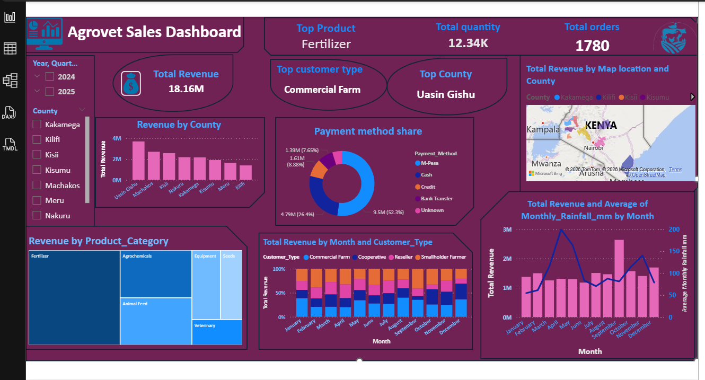

# Agrovet Sales Dashboard (Power BI)

Interactive Power BI dashboard built from 1,780 sample orders across eight Kenyan counties (2024 to 2025). It tracks 18.16M Kenya shillings (KES) in revenue, top products, payment methods and rainfall. Year, quarter and county filters help managers explore the data. Uasin Gishu led revenue at 3.7M.



## Business questions

- Which counties bring in the most revenue?
- Which products and customer types drive sales?
- How do customers pay?
- Does monthly rainfall move with monthly revenue?

## Headline numbers

| Metric | Value |
|---|---|
| Total revenue | 18.16M (Kenya shillings, KES) |
| Total orders | 1,780 |
| Total quantity | 12.34K |
| Top product category | Fertilizer |
| Top customer type | Commercial Farm |
| Top county | Uasin Gishu |
| Largest payment method | M-Pesa (52.3% of revenue) |

## Dashboard pages and visuals

- **KPI cards:** total revenue, total orders, total quantity, top product, top customer type, top county.
- **Slicers:** year and quarter, county.
- **Revenue by County:** bar chart, with a map of the same data.
- **Payment method share:** donut chart (M-Pesa, Cash, Credit, Bank Transfer, Unknown).
- **Revenue by Product Category:** treemap (Fertilizer, Agrochemicals, Animal Feed, Equipment, Seeds, Veterinary).
- **Revenue by Month and Customer Type:** 100% stacked column chart.
- **Revenue vs rainfall:** columns for monthly revenue, line for average monthly rainfall in millimetres (mm).

## Data cleaning (Power Query)

The source table is `Sales_Data` (13 columns at load). These are the main problems I found and how I fixed them.

| Problem | Fix |
|---|---|
| 20 duplicate rows (1,800 rows down to 1,780 unique orders) | Removed duplicates, then removed duplicates again on `Order_ID` |
| Order IDs with an `AG-` prefix | Stripped the prefix so IDs are numeric |
| County names in mixed case, spacing and spelling (`meru`, `NAKURU`, `UasinGishu`, `Kisii County`) | Trimmed text and used Replace Values to standardise each county |
| Payment methods typed many ways (`MPESA`, `Mpesa`, `mpesa`, `cash`) and 54 blanks | Replaced variants with one label. Blanks became `Unknown` |
| Dates in several formats (`2024-03-11`, `August 31, 2024`, `23-Nov-2024`, `31/10/2025`) | Custom column that detects each format and parses it, then set type to Date and renamed to `Order_Date` |
| Prices stored as text (`KES 1,100`, `Ksh 1,320`) | Removed currency text and commas, then changed type to number |
| Discounts stored two ways: plain numbers (`2.5`, `5`, `10`) and text with a % sign (`10.0%`) | Custom column `Discount_Fixed`: values of 1 or more are divided by 100, so everything ends up as a fraction (`0.1` means 10%) |
| Null values in discount and payment fields | Handled with Replace Values and a filter step |
| 54 blank payment methods and 91 blank sales reps | Filled with `Unknown` |
| 30 rainfall values of `-999` (a placeholder for missing data) | Replaced with null, then set to zero |
| 8 negative quantities (for example `-46`) and 2 extreme ones (`400`, `700`) | Treated as entry errors: negatives made positive, `400` changed to `40` and `700` to `70` |
| Map plotted Meru in Tanzania | Added `Map_Location` = `[County] & " County, Kenya"` and used it as the map location, so Meru stays Meru |
| No revenue column | Added `Revenue = Quantity x Unit_Price_KES x (1 - discount)` |

### Discount rule (custom column)

```
if [Discount_Pct] >= 1 or [Discount_Pct] = 2.5 then [Discount_Pct] / 100
else if [Discount_Pct] = 0 then 0
else [Discount_Pct]
```

### Date rule (custom column)

```
let t = Text.Trim([Order_Date]) in
if Text.Contains(t, "/") then Date.FromText(t, [Format="dd/MM/yyyy", Culture="en-GB"])
else if Text.Contains(t, ",") then Date.FromText(t, [Format="MMMM d, yyyy", Culture="en-US"])
else if Text.Length(t) = 11 then Date.FromText(t, [Format="dd-MMM-yyyy", Culture="en-US"])
else Date.FromText(t, [Format="yyyy-MM-dd"])
```

## Skills shown

Power BI, Power Query (M language), data cleaning and standardisation, Data Analysis Expressions (DAX), data modelling, map and chart design, dashboard layout.

## Files

- `Agrovet_Sales_Dashboard.pbix`: the Power BI report
- `images/`: dashboard preview and cleaning screenshots
- `README.md`: this file

## Notes

- The data is synthetic sample data, drafted with AI for this project. It does not come from a real business. The mess in it (mixed dates, spellings and price formats) was built in on purpose, to practise cleaning.
- Cleaning assumptions: negative quantities were treated as sign errors, not returns, and the two extreme quantities as extra-zero typos. Rainfall gaps were set to zero, which can pull the monthly rainfall average down slightly.
- The monthly rainfall figures are also AI-drafted sample values. They are not real weather records, so the revenue and rainfall link in the dashboard is for demonstration only.
